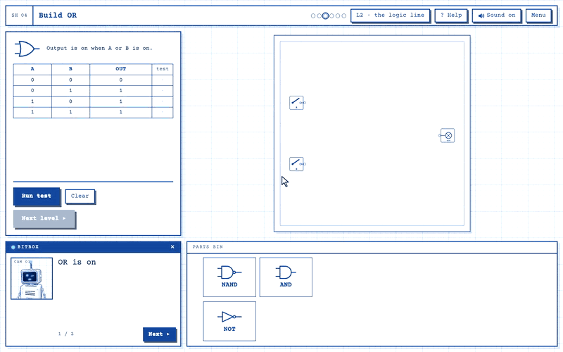
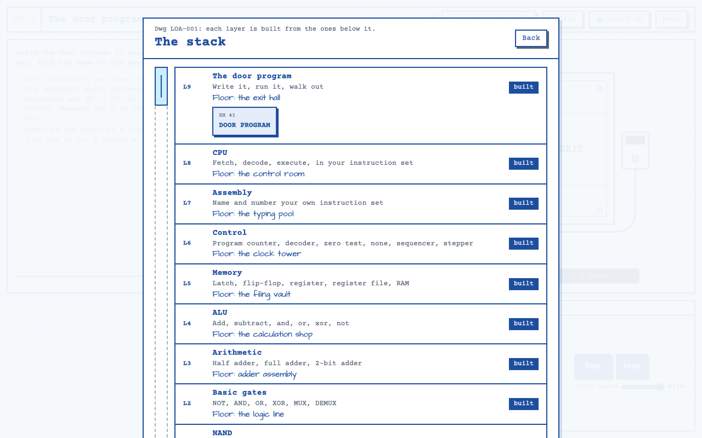

# Layers of Abstraction

A logic-gate puzzle game for the browser. You start with a single NAND gate and build your way up, one layer at a time, to a CPU that runs an instruction set you designed yourself.

**Play it at [abstract.dannyobrien.dev](https://abstract.dannyobrien.dev/)** (desktop browser).



## The game

A work lamp flickers on in an abandoned factory. Bitbox, a small robot, boots up with nearly empty memory banks. The exit is sealed, and it opens only for a program. Bitbox remembers just one schematic: the NAND gate.

From that one gate you build everything else across 41 levels. Each part you finish goes into your parts bin, ready to use on the next level. Each layer of the stack sits on its own floor of the factory:

| Layer | Floor                | What you build                                           |
| ----- | -------------------- | -------------------------------------------------------- |
| 1     | the gate foundry     | NAND, the one schematic Bitbox remembers                 |
| 2     | the logic line       | NOT, AND, OR, XOR, MUX, DEMUX                            |
| 3     | adder assembly       | Half adder, full adder, multi-bit adders                 |
| 4     | the calculation shop | An ALU: add, subtract, and, or, xor, not                 |
| 5     | the filing vault     | Latch, flip-flop, register, register file, RAM           |
| 6     | the clock tower      | Program counter, decoder, zero test, sequencer           |
| 7     | the typing pool      | Name and number your own instruction set                 |
| 8     | the control room     | A CPU: fetch, decode, execute, in your instruction set   |
| 9     | the exit hall        | Write the door program in your own assembly and walk out |

Each circuit is checked against the full truth table, or against test programs once you reach the CPU. Your game saves as you play.



## How it's built

- [SolidJS](https://www.solidjs.com/) and [Tailwind CSS](https://tailwindcss.com/) for the UI, with TypeScript, [Vite](https://vite.dev/) and [Bun](https://bun.sh/)
- An SVG board drawn like a drafting sheet. Wires follow the grid and route themselves around gates, crossings get a hop, and a dot marks each fan-out.
- A circuit simulator kept separate from rendering, so the game rules are covered by unit tests. It scales from single gates up to a full CPU running assembly.
- Bitbox is a [Three.js](https://threejs.org/) model with hand-keyed expressions, loaded on demand so it doesn't slow the first paint.
- A browser play-through that solves every level and records each one, so changes are checked against the real game.

## Run it locally

```sh
bun install
bun run dev     # dev server with hot reload
bun run check   # type check, lint, tests, production build
```

See [CONTRIBUTING.md](CONTRIBUTING.md) for the full toolchain, the browser play-through and the dev-only pages.

## Layout

- `src/sim/`: game rules with no rendering: the circuit, wire routing, levels, the CPU and assembler, saves.
- `src/ui/`: SolidJS components. `Board.tsx` draws the circuit and handles input, `Sheet.tsx` is the menu bar, brief and parts bin, and `script.ts` is everything Bitbox says.
- `src/robot/`: Bitbox in 3D: model, expressions, face screen and rendering.
- `docs/vision/board.html`: the vision board for the look, Bitbox and the story.
- `docs/adr/`: architecture decisions. `GLOSSARY.md`: the game's vocabulary.
